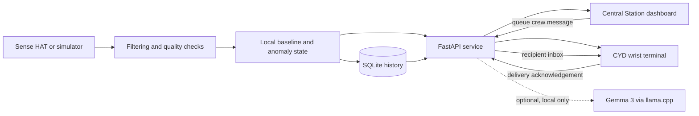

# ASTRA

**An offline-first environmental awareness and crew communication prototype for
NASA Space Apps 2026.**

ASTRA connects a Raspberry Pi 3 and Sense HAT backpack computer to a touchscreen
ESP32 wrist terminal and a browser-based Central Station. It learns the local
environment, detects unusual changes, records evidence, and keeps the crew-facing
experience available over a private local network—even when internet access is
gone.

> **Prototype notice:** ASTRA is a hackathon engineering prototype. It is not a
> medical device, emergency system, flight-certified instrument, or validated
> crew-safety product. Simulated data is identified throughout the system.

## The mission

Space crews cannot assume that cloud services will always be fast or reachable.
ASTRA puts the primary sensing and alert path at the edge:

1. A Sense HAT measures the backpack environment and motion.
2. A local FastAPI service filters, evaluates, and stores every sample.
3. A transparent baseline model produces `LEARNING`, `NORMAL`, `CAUTION`, or
   `ALERT` with a deterministic explanation.
4. Central Station and the wrist terminal receive updates over the private LAN.
5. If the backpack becomes unreachable, Central Station shows `OFFLINE` and the
   wrist terminal stops presenting old API values as live.

The core mission is simple: **notice a change, warn the crew, explain what
changed, and keep working without the internet.**

## System architecture



All required sensing, history, anomaly detection, summaries, dashboard delivery,
and crew messaging stay on the Raspberry Pi and local network. The local language
model is an optional experiment and never decides the sensor state.

## What is implemented

The current backend version is **0.6.0**.

| Area | Current capability |
| --- | --- |
| Backpack sensing | Live Sense HAT adapter plus deterministic normal/cycle simulation profiles |
| Edge processing | Environmental spike filtering, motion feature extraction, quality flags, and missing-value handling |
| Offline intelligence | Rolling local baseline, stabilized anomaly states, deterministic summaries, and restart recovery |
| Local storage | SQLite telemetry history and durable Central Station-to-wearable message queue |
| Central Station | Pi-hosted dashboard for status, trends, service health, provenance, simulated crew data, tasks, and message delivery |
| Wrist terminal | ESP32-2432S028 touchscreen UI for vitals, navigation, environmental readings, local configuration, history graphs, and recipient-scoped crew messages |
| Local AI | Optional single-turn Gemma 3 270M endpoint with bounded input/output, guardrails, validation, timeout, and safe fallback |

### Data provenance

ASTRA labels data at the point where it originates. A live Sense HAT sample does
not make the demo-only fields live.

| Data | Source in the current prototype |
| --- | --- |
| Temperature, humidity, pressure, acceleration, gyroscope, magnetometer, orientation | Live Sense HAT or explicitly simulated sensor adapter |
| Anomaly state, score, summary, motion features, quality | Deterministically derived on the Pi |
| Heart rate, blood pressure, oxygen saturation, body temperature | Simulated by default, or disabled |
| Suit pressure and suit-air temperature objects | Simulated by default, or disabled |
| Mission tasks | Simulated task catalog |
| Crew messages and delivery state | User-authored and stored locally in SQLite |
| Gemma response | Optional local model output, marked as model, guardrail, or fallback |

## Repository layout

| Path | Purpose |
| --- | --- |
| [`raspberry-pi/`](raspberry-pi/) | Python 3.11, FastAPI, SQLite, Sense HAT adapter, anomaly logic, messaging, dashboard hosting, and local Gemma integration |
| [`wearable/`](wearable/) | PlatformIO/Arduino firmware for the ESP32-2432S028 touchscreen wrist terminal |
| [`central-station/`](central-station/) | Browser dashboard assets served directly by the Pi |
| [`team/`](team/) | Owner guides, API documentation, and demo responsibilities |
| [`ai/`](ai/) | ASTRA-aware agent guidance and the reusable development skill |
| [`BOM.md`](BOM.md) | Hardware, power, cable, mounting, and recovery checklist |
| [`MILESTONES.md`](MILESTONES.md) | Build milestones and project activity log |

## Quick start

The fastest way to explore ASTRA is the deterministic simulated mode. It needs
Python 3.11 or newer and does not require the Raspberry Pi, Sense HAT, CYD, or a
Gemma installation.

```bash
git clone https://github.com/budip/NASA-SpaceApps-2026.git
cd NASA-SpaceApps-2026/raspberry-pi

python3 -m venv .venv
source .venv/bin/activate
python -m pip install -r requirements.txt

cp .env.example .env
set -a
source .env
set +a
export ASTRA_LLM_ENABLED=false

uvicorn app.main:app --host 0.0.0.0 --port 8000
```

Open the integrated interfaces:

- Central Station: <http://localhost:8000/dashboard>
- Swagger API: <http://localhost:8000/docs>
- Service health: <http://localhost:8000/health>
- Latest status: <http://localhost:8000/api/v1/status>
- Recent history: <http://localhost:8000/api/v1/history?limit=120>

The default `cycle` simulation learns from 20 samples, reaches normal operation,
and then creates a clearly simulated temperature/humidity event for six samples
each minute. Use `ASTRA_SIMULATION_PROFILE=normal` when a steady source is more
useful.

## Run on the Raspberry Pi and Sense HAT

Install the Raspberry Pi OS Sense HAT package, then select the live adapter:

```bash
sudo apt-get install sense-hat
export ASTRA_SENSOR_MODE=sense-hat
export ASTRA_SENSE_HAT_PYTHON=/usr/bin/python3
uvicorn app.main:app --host 0.0.0.0 --port 8000
```

The tested Raspberry Pi deployment uses the operating system's Python for the
Sense HAT driver and a persistent local JSON-lines bridge to the Python 3.11
FastAPI process. Sensor data stays on the Pi.

For boot-time service installation, operational commands, and the tested Pi
environment, see the [backend guide](raspberry-pi/README.md) and
[Raspberry Pi deployment notes](RASPBERRY_PI_SSH.md).

## Build the wrist terminal

The firmware targets the common ESP32-2432S028 CYD revision with an ILI9341
display. Board revisions differ, so verify the display, touch, backlight, USB,
and pin configuration before flashing.

1. Install PlatformIO.
2. Open [`wearable/`](wearable/) as the project.
3. Build and upload the `esp32-2432s028` environment.
4. On first boot, complete the four-point touch calibration.
5. Open **MENU → SET UP WI-FI + RASPBERRY PI**.
6. Join the temporary `Astra-Setup` network and open <http://192.168.4.1>.
7. Enter the private Wi-Fi and Pi API details, then save.

Wi-Fi credentials are stored locally on the device and must never be committed.
See the [wearable guide](wearable/README.md) for the UI, setup portal, display
designer, API fields, and board assumptions.

## API contract

The stable minimum `GET /api/v1/status` payload is:

```json
{
  "timestamp": "2026-11-13T18:30:00Z",
  "status": "NORMAL",
  "score": 0.18,
  "summary": "Conditions are within the learned baseline.",
  "sensors": {
    "temperature_c": 22.4,
    "humidity_pct": 41.0,
    "pressure_hpa": 1012.7,
    "acceleration_g": {"x": 0.01, "y": 0.02, "z": 1.0},
    "gyroscope_rps": {"x": 0.01, "y": 0.0, "z": -0.01},
    "magnetic_uT": {"x": 12.1, "y": -4.2, "z": 31.8},
    "orientation_deg": {"pitch": 2.0, "roll": 1.0, "yaw": 180.0}
  },
  "source": "live"
}
```

Contract rules:

- `status` is `LEARNING`, `NORMAL`, `CAUTION`, `ALERT`, or `OFFLINE`.
- `source` is `live`, `cached`, or `simulated`.
- Sensor fields may be `null`; a failed reading is never replaced with a
  believable zero.
- Every state has a deterministic local summary.
- Additive fields include motion `features`, data `quality`, `biometrics`,
  `suit_pressure`, `suit_temperature`, and `tasks`.

### Main endpoints

| Method | Path | Purpose |
| --- | --- | --- |
| `GET` | `/health` | Version, mode, sample freshness, baseline progress, and sampling health |
| `GET` | `/api/v1/status` | Latest complete ASTRA status |
| `GET` | `/api/v1/history?limit=120` | Chronological history, bounded to 1–300 rows |
| `GET` | `/api/v1/crew` | Wearable recipient roster |
| `POST` | `/api/v1/messages` | Queue a message for one crew member |
| `GET` | `/api/v1/messages` | Read the outbox or a recipient-scoped inbox |
| `POST` | `/api/v1/messages/{id}/ack` | Mark a displayed message as delivered |
| `GET` | `/api/v1/chat/health` | Check local Gemma readiness without loading the model |
| `POST` | `/api/v1/chat` | Request one bounded, single-turn local response |

The [Swagger/API guide](team/SWAGGER_API_GUIDE.md) documents request bodies,
response fields, provenance, examples, and error behavior.

## Offline behavior

Internet access is not required for:

- Sense HAT sampling or deterministic simulation;
- filtering, quality assessment, baseline learning, and anomaly states;
- SQLite history and baseline restoration;
- deterministic alert summaries;
- the Pi-hosted Central Station;
- status delivery to the CYD over the local network; or
- queued crew messaging and delivery acknowledgement.

Gemma also runs locally when its separately installed `llama.cpp` runtime and
model are available. It is deliberately outside the primary alert path because
generation takes tens of seconds on the tested Raspberry Pi 3. The model is not
included in this repository.

## Test

Run the backend test suite after installing its dependencies:

```bash
cd raspberry-pi
source .venv/bin/activate
python -m unittest discover -s tests -v
```

The suite covers anomaly learning and stabilization, missing data, filtering,
quality, SQLite restoration, Sense HAT normalization, simulated provenance,
suit thresholds, task selection, message isolation and acknowledgement, local
chat guardrails, concurrency, timeout, fallback, and OpenAPI exposure.

For an end-to-end rehearsal:

1. Start the backend with `ASTRA_SIMULATION_PROFILE=cycle`.
2. Open Central Station and wait for `LEARNING` to become `NORMAL`.
3. Observe the labeled simulated event produce `CAUTION` or `ALERT`.
4. Connect a configured CYD and queue a recipient-scoped message.
5. Confirm the wearable displays it and Central Station changes from `QUEUED`
   to `DELIVERED` after acknowledgement.
6. Remove internet access while leaving the private LAN active and confirm the
   core path continues.

## Current limitations and safety boundaries

- The anomaly model detects deviation from a recent local baseline; it does not
  identify every hazard or certify that conditions are safe.
- Sense HAT temperature is influenced by Raspberry Pi heat and is not a cabin
  or physiological reference measurement.
- Biometrics, mission tasks, and the default suit telemetry are simulated.
- The current CYD Suit Monitor reads ambient Sense HAT temperature and pressure
  from `sensors`; the separate backend suit objects remain demo-only simulated
  data.
- The API and message queue have no authentication. Keep port 8000 on a trusted
  private LAN and do not expose it directly to the internet.
- The local Gemma endpoint is experimental and must not provide medical,
  emergency, or flight-control decisions.
- Use only safe anomaly demonstrations. Avoid flame, liquids near electronics,
  extreme temperatures, unsafe acceleration, damaged batteries, exposed
  conductors, and blocked ventilation.

## Team and project guides

| Owner | Area | Guide |
| --- | --- | --- |
| Tyeki | Central Station and all control-center development | [`team/TYEKI.md`](team/TYEKI.md) |
| Ralph | CYD firmware, wrist experience, and 3D printing | [`team/RALPH.md`](team/RALPH.md) |
| Alex | User experience, testing, evidence, and demo | [`team/ALEX.md`](team/ALEX.md) |
| Budi | AI development and integration | [`team/BUDI.md`](team/BUDI.md) |

Additional references:

- [ASTRA 2026 project presentation](presentation/ASTRA-2026-Final.pptx)
- [Swagger and API guide](team/SWAGGER_API_GUIDE.md)
- [Hardware bill of materials](BOM.md)
- [Milestones and activity log](MILESTONES.md)
- [Raspberry Pi deployment notes](RASPBERRY_PI_SSH.md)

When changing a shared payload or display behavior, update every consumer and
keep live, cached, and simulated evidence clearly labeled.
